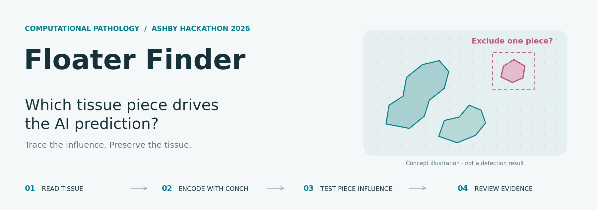
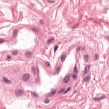
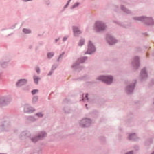
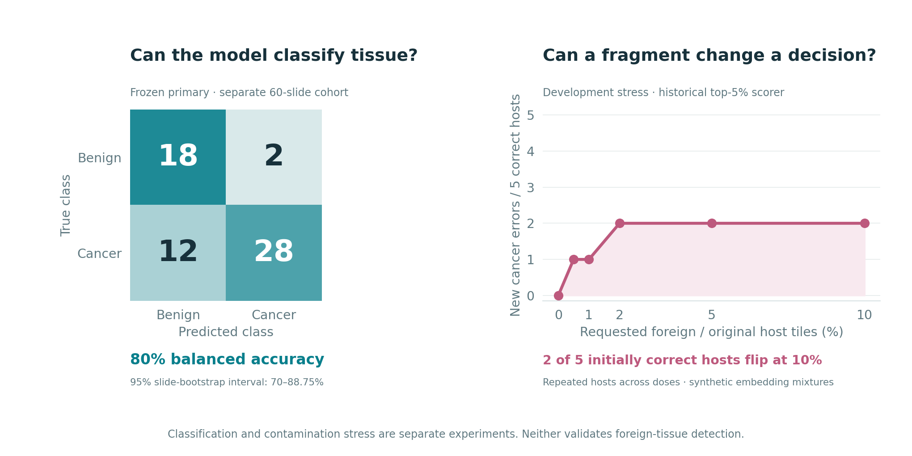

<p align="center">
  
</p>

<p align="center">
  <a href="https://www.python.org/"></a>
  <a href="docs/panda_integration.md"></a>
  <a href="tests/"></a>
  <a href="LICENSE"></a>
</p>

<p align="center">
  <a href="#start-with-the-tissue">The idea</a> ·
  <a href="#what-the-experiments-show">Results</a> ·
  <a href="#try-it-without-a-gpu">Try it</a> ·
  <a href="docs/panda_integration.md">Technical guide</a>
</p>

Floater Finder explores whether a small tissue fragment can disproportionately
influence a prostate-biopsy AI prediction. It combines real pathology images,
CONCH embeddings and **leave-one-piece-out analysis** to trace that influence.
Built by [Muneeb Hoda](https://github.com/MuneebHoda) for the **2026 Ashby Hackathon**.

> **Research prototype.** A decisive fragment may be genuine cancer. The system
> preserves tissue and reports evidence; a useful foreign-tissue detector has
> not yet been established.

## Start with the tissue

<table>
  <tr>
    <td align="center" width="50%"><br><b>Native tissue from a benign slide</b></td>
    <td align="center" width="50%"><br><b>Native tissue containing annotated cancer</b></td>
  </tr>
</table>

These are real PANDA reference tiles, not detected floaters.
[Image provenance](submission/ashby_20261021_v2/media/provenance.json).

The pipeline reads spatial tissue tiles, encodes them with **CONCH**, and asks:
**“Does the prediction change if this piece is excluded?”** It then checks native
cancer controls and known synthetic insertions to separate decision influence
from evidence of foreignness. An empty counterfactual is reported as unevaluable.

## What the experiments show

<table>
  <tr>
    <td align="center" width="33%"><b>120</b><br>PANDA slides in the initial cohort</td>
    <td align="center" width="34%"><b>50,729</b><br>verified CONCH embeddings</td>
    <td align="center" width="33%"><b>455</b><br>passing software tests</td>
  </tr>
</table>



**A working pipeline, with an important limit.** Classification and fragment
influence are measurable, but influence alone does not identify foreign tissue.
The fixed-support review candidate detected **3/24** foreign fragments while
alerting on **8/72** unmodified slides—failing its predefined utility targets.

[Baseline results and uncertainty](reports/panda_fresh_baseline_results_v1.md) ·
[Contamination experiment](reports/panda_s1_and_piece_results_20261020.md) ·
[Detector findings](reports/panda_stable_context_results_v1.md)

<details>
<summary><b>See why automatic tissue removal would be unsafe</b></summary>


These are sampled tile footprints, not complete tissue boundaries. Both native
annotated cancer and a known synthetic insertion can drive the same decision
change. **The counterfactual explains dependence; it does not diagnose a floater.**
[Measured examples and reproduction](reports/panda_s1_and_piece_results_20261020.md#real-leave-one-piece-out-diagnostic).

</details>

## Under the hood

**Python · PyTorch / CONCH · OpenSlide · NumPy · scikit-learn · Slurm**

- **Spatial processing:** bounded TIFF-pyramid reads, mask alignment, physical
  coordinates and annotation fractions. [Tiler](src/floater_finder/panda.py)
- **Model-independent analysis:** saved embeddings plus a supplied prediction
  callable. [Counterfactual engine](src/floater_finder/fragment_dependence.py)
- **Reproducible experiments:** frozen scorers, source-separated controls, exact
  oracle recovery and checksummed Slurm runs on NCSA Delta.
  [Research modules](src/floater_finder/research/) · [Job scripts](scripts/slurm/)

## Try it without a GPU

This small **artificial fixture** demonstrates the JSON output without pathology
data or model weights. Requires Python 3.11–3.12 and `uv`.

```sh
git clone https://github.com/MuneebHoda/floater-finder.git
cd floater-finder
uv sync --locked --no-editable --reinstall-package floater-finder
.venv/bin/python scripts/fragment_dependence_demo.py \
  --output results/fixtures/my-first-run
```

Open `results/fixtures/my-first-run/alert.fixture.json` for the baseline,
counterfactual predictions and piece geometry. Use a fresh output directory.
Fixture alerts are software examples, not research results.

<details>
<summary><b>Tests, full evidence and current research status</b></summary>

```sh
uv sync --locked --no-editable --reinstall-package floater-finder \
  --extra test --extra panda --extra research
.venv/bin/python -m pytest -q -W error
```

- [96-image pixel pilot](reports/panda_pixel_results_20261022.md): canonical
  CONCH re-encoding passed; no slide-prediction changes in 24 foreign edits.
- [10,000-candidate benchmark](docs/panda_pixel_program_v2.md): source-path
  correction passes 57/57 metadata checks; replacement CPU/GPU execution is pending.
- The original 24 final-test slides remain unscored. Patient independence and
  clinical utility are unverified; no pathologist review is claimed.
- [Progress log](reports/progress.md) · [Delta setup](docs/ncsa_setup.md) ·
  [Historical workflows](docs/research_history.md).
- Rebuild the two overview panels with `python scripts/build_readme_assets.py`
  using the optional `plots` dependencies. [Figure inputs and hashes](docs/assets/readme/provenance.json).

</details>

---

[MIT License](LICENSE) · Code by [Muneeb Hoda](https://github.com/MuneebHoda) ·
Research execution on **NCSA Delta**. PANDA data and CONCH weights retain their
own access and licensing terms. Full datasets and checkpoints are not bundled.
