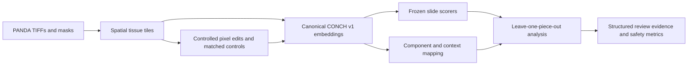
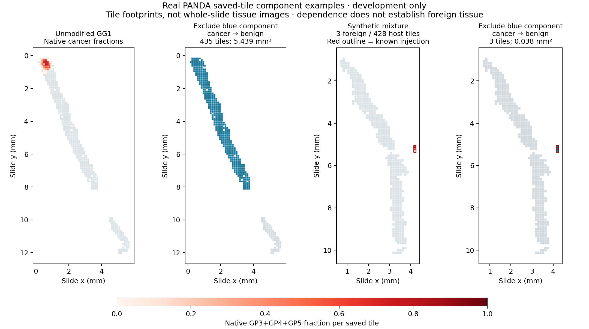

# Floater Finder

**Computational pathology research on how small tissue fragments influence AI predictions.**

Built for the **2026 Ashby Hackathon** by [Muneeb Hoda](https://github.com/MuneebHoda).
Floater Finder combines spatial whole-slide image processing, frozen CONCH
representations, controlled contamination experiments and counterfactual analysis
in a reproducible Python pipeline on NCSA Delta.

The central question: **which tissue pieces drive a biopsy prediction, and can
we distinguish a consequential foreign fragment from genuine small cancer?**
The software preserves the original tissue and prediction, then reports evidence
for review. A decision-changing piece is not automatically labeled foreign.

**Current status:** working research pipeline, **455 passing software tests**,
verified real-data GPU execution, and documented positive and negative findings.
A clinically useful floater detector has **not** been established.

## What this project demonstrates

- **Spatial data engineering:** bounded PANDA pyramid-TIFF reads, aligned Radboud
  grading masks, physical tile coordinates/areas and per-tile annotation fractions.
- **ML systems:** canonical CONCH v1 image/text encoding, frozen linear and
  zero-shot scorers, model/preprocessing fingerprints and embedding drift checks.
- **Counterfactual analysis:** a model-agnostic leave-one-piece-out engine that
  recomputes predictions and explicitly abstains when exclusion leaves no tissue.
- **Experimental design:** source-disjoint splits, connected-fragment stress
  tests, matched native/seam/null controls and genuine-cancer safety comparisons.
- **HPC execution:** bounded Slurm CPU/GPU stages, dependency gates, actual charge
  reconciliation and checksummed source/input/output receipts.
- **Scientific reproducibility:** frozen protocols, exact oracle checks, explicit
  metric denominators, preserved failures and an original final-test seal.

## Pipeline



Clean sampling does not use grading masks to select tissue; annotation-guided
donor extraction is kept separate. Saved embeddings let most scoring and
counterfactual experiments run on CPUs without repeating GPU inference.

## Verified results

These studies have different cohorts and denominators. Classification,
dependence and foreign-fragment detection are separate outcomes.

| Study | Observed result | Evidence |
| --- | --- | --- |
| Initial PANDA pipeline | **120 slides / 50,729** verified 512D CONCH embeddings; 72/24/24 train/calibration/test split | [Pipeline and development results](reports/panda_s1_and_piece_results_20261020.md) |
| Separate frozen cancer baseline | **80.0% balanced accuracy** on 60 Radboud slides; slide-bootstrap 95% interval 70.0–88.75%; cancer recall **28/40** | [Baseline report and confusion matrices](reports/panda_fresh_baseline_results_v1.md) |
| Connected-fragment S1 development stress | **192/192 exact oracle recoveries**; verifies restoration of original inputs/predictions, not learned detection | [S1 protocol and outcomes](reports/panda_s1_and_piece_results_20261020.md) |
| Fixed-support review candidate | **3/24** foreign fragments detected; **8/72** unmodified slides alerted; **failed** the frozen utility gate | [Negative detector findings](reports/panda_stable_context_results_v1.md) |
| Real pixel-level CONCH pilot | **96 images**, four repeated training pairs; source/null drift checks passed; **0/24** foreign edits changed slide predictions | [Pixel pilot measurements](reports/panda_pixel_results_20261022.md) |

In the pixel pilot, foreign edits had higher NN5 anomaly scores than matched
native edits in 8/8 comparisons at 5% patch area and 7/8 at 10%. Those percentages
describe a patch **within one tile**, not a slide. Rectangular editing artifacts
remain a confounder; the observation does not validate a foreignness detector.

### Why genuine-cancer controls matter



These are measured sampled-tile footprints, not whole-slide tissue photographs.
Both a genuine annotated cancer-containing component and a known synthetic
foreign component change cancer to benign when excluded. **Dependence alone
cannot justify tissue removal.** [Example provenance and reproduction](reports/panda_s1_and_piece_results_20261020.md#real-leave-one-piece-out-diagnostic).

## Try the software locally

Requires Python **3.11–3.12** and `uv`. The following installs the locked software
dependencies, runs the tests and executes an **artificial software fixture**.
It requires no pathology images, model checkpoint, NCSA account or GPU.

```sh
git clone https://github.com/MuneebHoda/floater-finder.git
cd floater-finder
uv sync --locked --no-editable --reinstall-package floater-finder \
  --extra test --extra panda --extra research
.venv/bin/python -m pytest -q -W error
.venv/bin/floater-finder --help
.venv/bin/python scripts/fragment_dependence_demo.py \
  --output results/fixtures/portfolio-demo
```

The fixture saves/reloads embeddings and writes `alert.fixture.json` with baseline
and counterfactual predictions, component geometry and artificial review alerts.
Its invented scorer and arrays are **software checks, not scientific results**.
Choose a fresh output directory; existing artifacts are not overwritten.
[Example fixture JSON](examples/fragment_dependence/alert.fixture.json).

Real encoding uses a separately prepared Delta environment, an authorized local
CONCH checkpoint and scheduled CUDA resources. Whole-slide datasets and model
weights are not bundled; the encoder disables implicit model downloads.
See the [PANDA integration guide](docs/panda_integration.md) and
[verified Delta setup](docs/ncsa_setup.md) for research execution.

## Explore the implementation

| Area | Entry point |
| --- | --- |
| TIFF tiling, mask alignment and physical geometry | [`panda.py`](src/floater_finder/panda.py) |
| CONCH adapter and artifact validation | [`conch.py`](src/floater_finder/conch.py), [`panda_encoding.py`](src/floater_finder/panda_encoding.py) |
| Scorer-independent piece counterfactuals | [`fragment_dependence.py`](src/floater_finder/fragment_dependence.py) |
| Frozen predictors and grouped evaluation | [`predictors/`](src/floater_finder/predictors/) |
| Controls, shared interventions and experiment registry | [`research/`](src/floater_finder/research/) |
| Cluster execution | [`scripts/slurm/`](scripts/slurm/) |
| Protocols, measured results and regression tests | [`docs/`](docs/), [`reports/`](reports/), [`tests/`](tests/) |

The original TCGA organ-classification workflow is preserved as historical work;
its results are not reused as evidence of prostate cancer or floater detection.
[Detailed workflow/history](docs/research_history.md) · [Progress log](reports/progress.md).

## Limits and next steps

- The original **24 final-test slides remain unscored**. No failed development
  detector was promoted by inspecting or tuning on those outcomes.
- PANDA source-slide separation is recorded, but patient independence is not
  verified. Findings use bounded tissue sampling and synthetic contamination;
  natural floaters and clinical utility have not been adjudicated.
- Genuine annotated cancer may be decisive. No automatic tissue deletion occurs,
  and no expert-review judgments are fabricated.
- A **10,000-candidate** image/control benchmark is prepared. Its first CPU run
  failed a source-metadata check; a versioned correction now passes 57/57
  metadata checks. Replacement preparation and large-benchmark GPU results
  remain pending. [Correction and execution gates](docs/panda_pixel_program_v2.md).

## License and acknowledgments

Code is available under the [MIT License](LICENSE). PANDA data and CONCH model
weights have their own access and licensing requirements. Full datasets and
checkpoint files are not distributed with the code; committed research and
presentation figures retain their recorded provenance. Research execution used
**NCSA Delta**. See the linked protocols and reports for dataset/model provenance
and scientific references.
