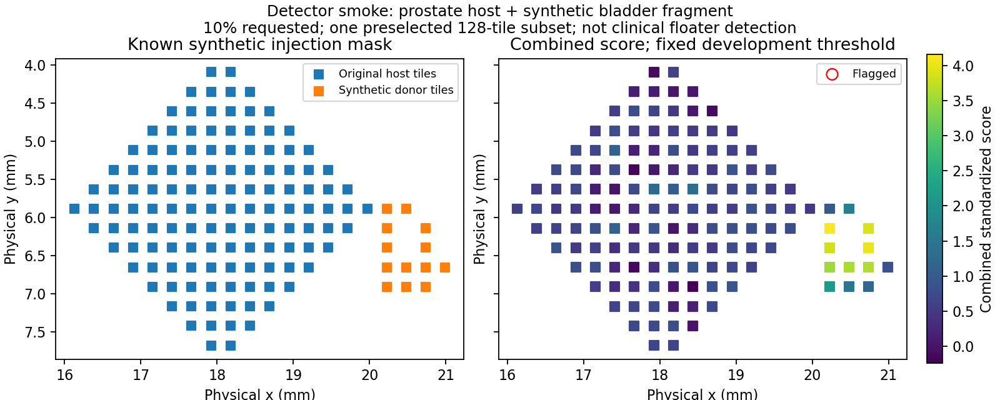

# Patient-separated CONCH v1 detector smoke

The end-to-end workflow runs successfully, but the fixed 99th-percentile combined threshold is conservative in this small smoke. At 10% requested contamination it detects only **3.85%** of the injected donor tiles on average, despite ranking them with mean AUROC **0.949**. This is not a useful sensitivity claim or a cohort benchmark.

Two unmodified development patients (`TCGA-2A-A8VO`, `TCGA-2F-A9KO`) supply 256 calibration tiles. Separate evaluation patients (`TCGA-2A-A8VL`, `TCGA-2F-A9KP`) are reciprocal hosts/donors, 128 original tiles each. Each requested level and seed is evaluated separately. Clean means no synthetic injection; native contamination has not been reviewed by a pathologist.

Settings were frozen before detector evaluation: 1 mm exclusion, 0.1 mm smoothing, equal organ/visual weighting and a 99th-percentile clean-development threshold. There are six levels, five seeds, 60 oracle passes, 180 variant rows and zero exclusions. Seeds, percentages and reciprocal directions do not add independent patients. Controls include organ-only, visual-only, combined, no filtering, exact oracle and seeded random removal of the same number of tiles.

| Variant | Mean tile AUROC | Mean injected-tile detection rate | Mean original-host removal rate |
| --- | ---: | ---: | ---: |
| organ_only | 0.701 | 23.08% | 1.17% |
| visual_only | 0.920 | 5.38% | 0.00% |
| combined | 0.949 | 3.85% | 0.00% |

This table averages ten synthetic trials: two evaluation hosts × five seeds at 10% requested contamination, realized as 13/128 = 10.15625%. Each trial has 13 injected positives and 128 original-host negatives. These are repeated subset observations, not ten independent patients. At zero injection, tile AUROC and donor-detection rate are undefined and recorded as null.

On the two unique unmodified evaluation controls, organ-only removed 0/128 and 3/128 original tiles; visual-only and combined removed 0/128 on both. Measured development false-alarm rate was 2/256 = 0.78125% for each variant; this does not guarantee a 1% rate on unseen slides.

The map is the preselected prostate-host, seed-0, 10%-requested trial. None of its tiles crosses the combined threshold 4.3558, although donor tiles have higher scores. It illustrates the difference between ranking and threshold sensitivity; it is not clinical floater detection.

Independent validation retrieved and matched 184 file hashes, recomputed all 60 oracle trials, and reproduced every variant's flags and count metrics. Maximum standardized-score difference across Delta NumPy 2.2.6 and local NumPy 2.0.2 was 1.47e-6, within the recorded float32 tolerance. Full evidence: [validated detector report](conch_detector_smoke_22994885.json), [raw variant metrics](metrics/conch_detector_22994885.csv), and `results/smoke/conch_detector_22994885/` for per-tile arrays, injection metadata and full controls.

Next research work needs a larger, representative development cohort and a fresh held-out evaluation cohort. The present evaluation cases must not be used to tune the threshold. Whole-slide sampling, institution normalization, report linkage, clinical validation and population performance remain unverified.
