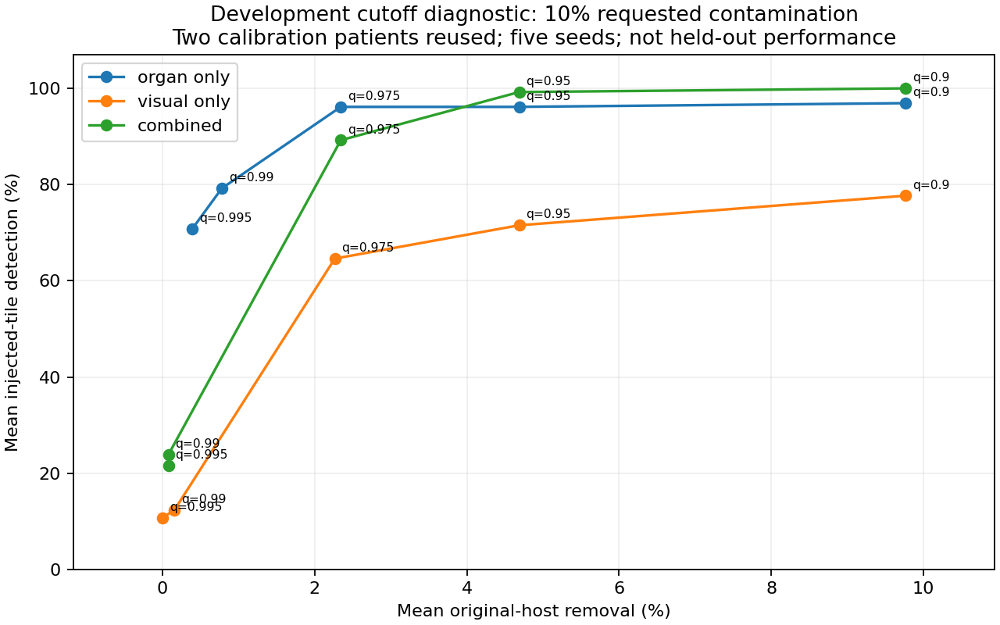

# Development-only CONCH v1 cutoff diagnostic

CPU Slurm job **22995268** completed `0:0` on `cn004` in 12 seconds, requesting two CPUs, 4 GB and five minutes. It reused the existing development embeddings; no new slide, checkpoint, GPU inference or evaluation artifact was needed. All 60 oracle checks passed; five cutoff levels and three variants produced 900 metric rows, with zero exclusions.

These are **development resubstitution observations**. The same two patients (`TCGA-2A-A8VO`, `TCGA-2F-A9KO`) supplied clean calibration and synthetic host/donor trials. Each has 128 tiles. Repeated seeds and contamination levels do not add independent patients. Native contamination has not been pathologist-reviewed. These results do not revise the separate, previously completed evaluation smoke.

The combined-score diagnostic at **10% requested contamination** is:

| Clean calibration quantile | Mean injected-tile detection | Mean original-host removal in mixed trials | Removal on unique unmodified calibration tiles |
| --- | ---: | ---: | ---: |
| 90% | 100.00% | 9.77% | 25/256 = 9.77% |
| 95% | 99.23% | 4.69% | 12/256 = 4.69% |
| 97.5% | 89.23% | 2.34% | 6/256 = 2.34% |
| 99% | 23.85% | 0.08% | 2/256 = 0.78% |
| 99.5% | 21.54% | 0.08% | 1/256 = 0.39% |

Each mixed-trial mean covers two reciprocal development hosts × five seeds, with 13 injected positives and 128 original-host negatives per trial. Realized contamination is 13/128 = 10.15625% of the original host count. The unmodified-control column counts the two patients once. Injected fragments can alter visual reference neighbors and therefore original-host scores; clean-control and mixed-trial removal rates need not agree.

Lowering the cutoff increases detection while removing more original tissue. At the 97.5th percentile, the unmodified prostate subset alone loses 6/128 = 4.69%; the bladder subset loses 0/128. A pooled rate hides that difference. No cutoff was selected. The existing nominal 1% clean-tile budget remains a reference, with no unseen-patient guarantee.

All 127 retrieved artifacts match their remote hashes. Independent dense small-array calculations reproduced all 60 oracles and all 900 stored-score count metrics/AUROCs. Maximum score difference between local NumPy 2.0.2 and Delta 2.2.6 was 1.79e-6. Using each runtime's own recomputed calibration thresholds reproduced every flag. Applying Delta thresholds directly to locally rounded scores causes 168 repeated tile/threshold/trial disagreements, all within 1e-5 of a threshold; they are not 168 distinct tiles. The original Delta arrays and thresholds reproduce all published metrics exactly. The published figure was rendered locally from the verified report with wider axis margins; the original remote figure is preserved.

Evidence: [validated report](conch_threshold_diagnostic_22995268.json), [raw metrics](metrics/conch_threshold_22995268.csv), [frozen configuration](../configs/ncsa_threshold_diagnostic.json), and ignored local arrays under `results/development/conch_threshold_22995268/`. Remote originals remain at `/work/nvme/bfqi/mhoda/floater-finder/diagnostics/threshold-20261018T222409Z`.

Next: resolve dependency maintenance before expanding raw-image processing, prepare a verified larger development cohort and fresh held-out cohort, declare the acceptable host-removal budget, then freeze and test the protocol. Existing evaluation patients must stay out of parameter selection. This diagnostic does not establish clinical floater detection or whole-slide performance.
