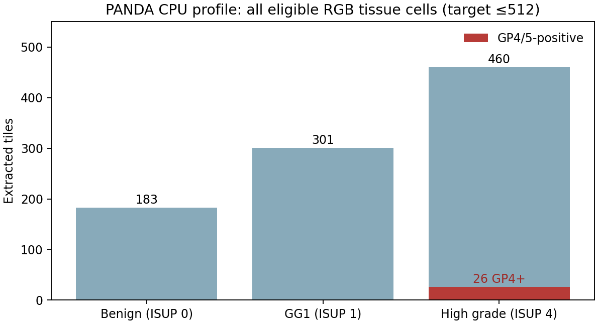
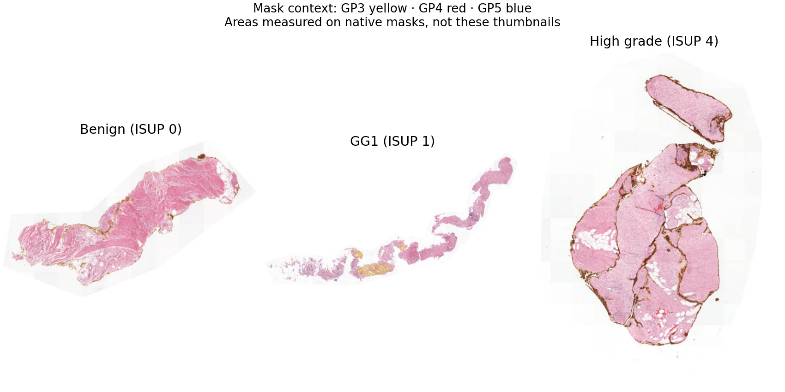

# PANDA scale-up checkpoint — October 20, 2026

**Latest executed status:** 120 images and 120 masks acquired and receipt-verified as job **23051626** (0:0, 3:42). Corrected GPU profile **23051673** passed (0:0, 54 seconds), producing **944 verified 512-dimensional embeddings**; the namespace-package failure **23051627** is preserved. First cohort CPU job **23051691** passed all ten native-mask audits and 3,528 representative tiles. Remaining native-mask audits/tiling are running as **23051907** (one job, four workers, respecting `cpuintqos`'s one-submitted/one-running-job limit). Full-cohort GPU encoding remains unsubmitted and needs a measured, separately approved request after CPU gates. No clean cancer baseline or contamination experiment has run.

[Acquisition evidence](panda_acquisition_completed_23051626.json) · [GPU evidence](panda_gpu_profile_23051673.json) · [Measured GPU profile chart](figures/panda_scale_profile_23051673/gpu_profile.png) · [Measured resource estimates](panda_gpu_resource_estimate_20261020.json) · [Acquired 120-slide manifest](manifests/panda_acquired_120_20261020.csv) · [CPU submissions](panda_cohort_cpu_submissions_20261020.json). The rest of this document preserves the earlier preparation checkpoint and exact approval commands.

**Approval and execution update:** the user approved the 120-slide acquisition plus cancellation/replacement, and independently approved the five-minute GPU profile. Original job `23030528` was verified cancelled. Replacement acquisition **`23051626`** and GPU profile **`23051627`** were each submitted once using the prepared commands below. Their completion and artifact validation are pending; larger GPU batches remain unapproved. [Submission record](panda_scale_approved_submission_20261020.json). The approval language below records the earlier review checkpoint.

The acquisition path is now planned for **60 or 120 balanced Radboud slides**, and real CPU cancer capture passed. **Only three images have been processed.** No new WSI/mask download, GPU inference, cancer baseline or contamination evaluation has run in this stage. The GG1 mask was recovered from an existing local ZIP.

## Verified data access and candidate cohorts

Delta shared SSH confirmed `mhoda` on `dt-login04.delta.ncsa.illinois.edu`. Official Kaggle client 2.2.4 listed **21,135 files**. Initial rapid pagination received HTTP 429; slower pagination completed, retaining only file names/sizes and no signed URLs or credentials. A selective `train.csv` probe reproduced the original 520,203-byte file and SHA256. A proposed new image and mask returned HTTP 200 through streamed-header probes; their bodies were not read/saved. There is no current authentication/rules blocker. [Probe evidence](panda_selective_access_probe_20261020.json).

Original metadata plus file catalog provides 967 eligible benign, 852 GG1 and 1,741 high-grade Radboud image candidates. **Catalog availability does not establish usable masks or cancer-positive tissue.** Both candidate plans have a catalog-listed mask for every selected slide; only the three existing masks have been decoded and audited.

| Candidate plan | Per group | Train/calibration/test per group | Additional images / masks | Exact additional catalog file bytes | Complete input file bytes |
|---|---:|---|---|---:|---:|
| 60 | 20 | 12 / 4 / 4 | 57 / 57 | 1,201,123,589 | 1,232,470,464 |
| 120 | 40 | 24 / 8 / 8 | 117 / 117 | 2,459,351,119 | 2,490,697,994 |

These are exact **uncompressed catalog TIFF sizes**, not measured ZIP network transfer totals. ZIP overhead/temporary extraction storage is additional; actual transfer bytes for the full plan remain unknown. The two plans are nested with unchanged splits for shared slides, seed `20261020`; exposed engineering cases stay training-only. Selection prioritizes known GP4/5-positive cases and catalog masks. All patient identities remain unknown: only slide separation is verified. No patient independence or per-tile ground truth from slide grades is assumed.

New remote plan directory: `/work/nvme/bfqi/mhoda/panda/cohort-plans/20261020-scale-v1`; `candidate_60.csv`, `candidate_120.csv`, `acquisition_60.json`, `acquisition_120.json`, `provenance.json`. Original `annotated_cohort.csv` and `pilot.csv` are unchanged. [60 candidates](manifests/panda_candidate_60_20261020.csv), [120 candidates](manifests/panda_candidate_120_20261020.csv), [selection provenance](panda_scale_provenance.json), [120-slide stage ledger](panda_scale_ledger_20261020.json).

Storage snapshot: filesystem available **4,037,942,358,016 bytes**; project 20283 soft-quota headroom **4,037,865,287,680 bytes**, shared with other users. No per-user block limit was reported. These are observations, not reserved space. Catalog-selected inputs plus estimated PNG/embedding files are well below this snapshot.

## Acquisition repair and approval gate

Job **23030528** remains **PENDING / Priority**. Its submitted shell loads the Kaggle environment, probes `train.csv`, then invokes missing `/work/nvme/bfqi/mhoda/panda/collect_annotated.py`; its expected log does not exist. The shell contains no recoverable cohort selector. It will fail at the missing dependency if started in this state. It and its paths were preserved; no duplicate was submitted and the missing target was not filled with an unapproved bulk downloader.

The replacement is a separate versioned `panda_acquire.py`/`panda_acquire.sbatch`. It requires the exact approved plan SHA256, downloads individual official files, validates catalog sizes and ZIP CRC where packaged, computes local SHA256 receipts, publishes files exclusively, and resumes without overwriting existing files. External source checksums are not supplied by this catalog; local SHA256 receipts are not claimed as independent source checksums. Auth/network failures stop with sanitized errors. It does not select new cases, download weights, submit jobs, or cancel the old job itself.

Proposed acquisition resources: CPU account/QoS `bfqi-delta-cpu`, partition `cpu-interactive`, 2 CPUs, 4 GB, 1 hour maximum (2 CPU-hours). Choose exactly one plan. After explicit cancellation/replacement approval, first run `scancel 23030528`, verify it is terminal, then the corresponding command:

```sh
# Preferred 120-slide acquisition; NOT SUBMITTED
sbatch --parsable /u/mhoda/floater-finder/releases/panda-scale-ready-20261020T180556Z-v2/source/scripts/slurm/panda_acquire.sbatch /u/mhoda/floater-finder/releases/panda-scale-ready-20261020T180556Z-v2/source /work/nvme/bfqi/mhoda/panda/cohort-plans/20261020-scale-v1/acquisition_120.json /work/nvme/bfqi/mhoda/panda /work/nvme/bfqi/mhoda/panda/acquisition-receipts/20261020-scale-v1-120 198478f7ee73aa9e0b7bd6f676b641805d93ce658e309eb24dd598e70f8484f7

# Alternative 60-slide acquisition; NOT SUBMITTED
sbatch --parsable /u/mhoda/floater-finder/releases/panda-scale-ready-20261020T180556Z-v2/source/scripts/slurm/panda_acquire.sbatch /u/mhoda/floater-finder/releases/panda-scale-ready-20261020T180556Z-v2/source /work/nvme/bfqi/mhoda/panda/cohort-plans/20261020-scale-v1/acquisition_60.json /work/nvme/bfqi/mhoda/panda /work/nvme/bfqi/mhoda/panda/acquisition-receipts/20261020-scale-v1-60 64edc5e4123e1fdaf29d353002fb1f0bb942b05dde21131a66013e5e5a68a0e3
```

## Executed CPU profile and cancer coverage

Job **23051244** completed **0:0** on `cn096`, 41 seconds scheduler elapsed / 32 seconds task elapsed, peak task RSS **260 MB**. It used the approved bounded existing-data scope, 2 CPUs, 8 GB, 15-minute cap, CPU account/QoS `bfqi-delta-cpu`, `cpu-interactive`. Source snapshot: `/u/mhoda/floater-finder/releases/panda-scale-20261020T175626Z/source`; archive SHA256 `0613a39701f0068bc84f5d5725ff548f13a511f293fa757e5c214cd7697e8c37`. Raw output: `/work/nvme/bfqi/mhoda/floater-finder/panda-profile/20261020T175626Z`.

| Existing biopsy | Representative tiles | Nonzero GP4/5 tiles | Native mask findings |
|---|---:|---:|---|
| Benign `afe7…` | 183 | 0 | No GP3/4/5 pixels |
| GG1 `55d9…` | 301 | 0 | 693,548 GP3 pixels; 0 GP4/5 |
| High grade `dd11…` | 460 | **26** | **88,020 GP4 pixels = 0.020806028382116183 mm²**; 0 GP5 |

All 944 representative tiles came from complete RGB-screened grids, without mask enrichment. The 512 target was not forced when tissue was insufficient. This is a grid/tissue-screen sample: partial edge cells and RGB-negative cells remain excluded. Native mask dimensions/orientation/pyramids aligned; all three masks were read completely in ≤512×512 blocks. Physical MPP was measured from TIFF tags, not assumed from magnification. Approximate level-1 cancer counts are superseded here by native counts.

The separate donor output contains **19 tiles**, each ≥1% GP4/5; maximum GP4 fraction 42.78%, median 3.60%. They form **two 8-connected candidate components of 14 and 5 tiles**, not one 19-tile fragment. Future injections must use genuine connected subsets and exclude infeasible requested sizes; do not repeat donor vectors to fill a quota. The representative tiles cover all 88,020 native GP4 annotation pixels (floating-point area agreement within 1e-12); donor tiles cover 97.93% of that annotated area. This is annotation coverage, not proof that every cancer cell is labeled. [Coverage calculation](panda_cpu_profile_23051244_coverage.json). Only **one high-grade mask has verified GP4/5-positive regions** so far. The 20/40 new high-grade cases require real mask validation before donor eligibility.

All **963 tile PNG hashes/dimensions, CSV/metadata hashes, coordinate geometry and label-fraction sums** were independently rechecked locally. The recovered GG1 mask passed ZIP CRC, header/alignment and native decoding; the existing pilot/partial/train CSV hashes were unchanged. These are engineering extraction outcomes, not model accuracy. [Full CPU evidence](panda_cpu_profile_23051244.json), [executed source hashes](provenance/panda_cpu_profile_23051244_source.json).




Reproduce figures: `.venv/bin/python scripts/plot_panda_profile.py --profile results/panda/profile_23051244/profile.json --output <fresh-directory>`.

## Implementation and next schedule

- `panda.py`: explicit expanded-manifest reader; complete-grid seeded representative sampling; separate mask-enriched donor mode; configurable 256–512 profiling targets; physical coordinates, mask fractions and selection provenance retained. Existing TCGA tiler and old PANDA smoke outputs are preserved.
- `panda_masks.py`: native streamed area/label/bounds audit and context overlays.
- `panda_cohort.py` and acquisition scripts: deterministic catalog-backed nested cohorts, versioned files, planned/acquired/verified states and per-file receipts. No patient IDs are invented.
- `panda_tile_cohort.py`: checkpointable CPU slices of ≤10 slides; exact input/source/artifact hashes prevent stale reuse and preserve partial failures.
- `panda_encoding.py`: uses the existing canonical CONCH encoder; validates all input PNGs, coordinates, IDs, prompt/model/runtime/source identities and per-slide completion receipts before reuse. Each completed slide survives a later failure. Incomplete output directories stop for inspection. The existing encoder loads a model per slide, so the profile must include that overhead.
- `panda_morphology_v1.yaml`: candidate benign/cancer and low/high morphology prompt ensembles fixed before any new scoring; not a validated scorer. Cancer/grade baselines, trained heads, contamination, detector comparisons and scientific metrics remain behind the data/encoding/baseline gates. No TCGA organ accuracy is reused as cancer evidence.

Final job preparation uses the separately verified read-only source `/u/mhoda/floater-finder/releases/panda-scale-ready-20261020T180556Z-v2/source` (213 files). The source is based on commit `985e646` plus the tested working changes; it is not represented as a new pushed commit. Acquisition and GPU scheduler dry runs passed without submission. [Prepared commands and source archive identity](panda_scale_prepared_submission_20261020.json), [prepared source hashes](provenance/panda_scale_prepared_source_20261020.json).

Current local suite: **165 passed**, including pyramid/mask/geometry, representative-mask independence, full native area, cohort quota/nesting, acquisition resume/preservation and embedding-reuse corruption checks. Slurm script syntax checks passed.

Runtime verified by metadata and the completed CPU reader job: NumPy 2.0.2, Pillow 12.3.0, OpenSlide Python 1.4.6/binary 4.0.1.2, tifffile 2025.5.10, Torch 2.8.0+cu128, torchvision 0.23.0+cu128, CONCH 0.1.0. The pinned existing CONCH checkpoint is 802,235,437 bytes; no new weights are needed. Current allocations show 5,758 rounded CPU hours and 9 rounded GPU hours. Current associations confirm GPU account `bfqi-delta-gpu` / QoS `bfqi-delta-gpu-mhoda`; no event reservation is assumed.

1. After approval, replace the broken pending acquisition and selectively acquire the chosen plan, preserving per-file receipts. Validate all images/masks and native high-grade GP4/5 eligibility in bounded CPU slices before embedding.
2. CPU tiling: ≤10 slides/job, 2 CPUs / 8 GB / 15 minutes. Observed mean for the three full audit-plus-tiling profiles was 10.43 seconds/slide; larger slides remain unprofiled. At 256–512 representative tiles/slide, 60 slides would export ≤15,360–30,720 tiles and 120 ≤30,720–61,440, with actual counts governed by tissue. Observed PNG storage extrapolates to approximately 1.15–2.31 GB / 2.31–4.61 GB respectively, excluding donor views. These are engineering estimates, not measured cohort runs.
3. **Separate approval requested** for one 5-minute A100 profile on the existing three representative views (**944 tiles**), 1 GPU / 4 CPUs / 16 GB, `gpuA100x4-interactive`, existing GPU account/QoS. Maximum requested GPU time: **0.0833 GPU-hour**. New output: `/work/nvme/bfqi/mhoda/floater-finder/panda-embeddings/profile-20261020-v1`. No cohort GPU batch is approved or submitted. Exact command:

```sh
sbatch --parsable /u/mhoda/floater-finder/releases/panda-scale-ready-20261020T180556Z-v2/source/scripts/slurm/panda_encode_profile.sbatch /u/mhoda/floater-finder/releases/panda-scale-ready-20261020T180556Z-v2/source /work/nvme/bfqi/mhoda/floater-finder/envs/panda-cpu-1598f9b-20261020T040441Z /u/mhoda/floater-finder/releases/panda-scale-ready-20261020T180556Z-v2/source/configs/panda_encode_profile_directories.json /work/nvme/bfqi/mhoda/floater-finder/panda-embeddings/profile-20261020-v1
```

4. Use the measured GPU load/inference time and peak memory to estimate 60/120-slide GPU hours, then request the specific larger batch approval. PANDA GPU throughput is **unknown** until this profile runs; the scheduler dry run is not GPU inference validation.
5. Evaluate clean benign/cancer and low/high baselines using representative embeddings only, with fixed prompts and split-specific accuracy, balanced accuracy, confusion matrices and errors. Fit a simple head only if needed, using training data only. Keep final test slides sealed while tuning; patient-level independence remains unverified. Only then run bounded connected-fragment contamination and calibration comparisons, with oracle recovery, explicit infeasible pairs and unique-slide denominators. Score/contamination charts require executed results, not fixtures or job completion.

**Required next action:** approve one exact acquisition plan plus cancellation/replacement of 23030528, and independently approve or defer the five-minute GPU profile. No password, API key or other credential is currently required.
